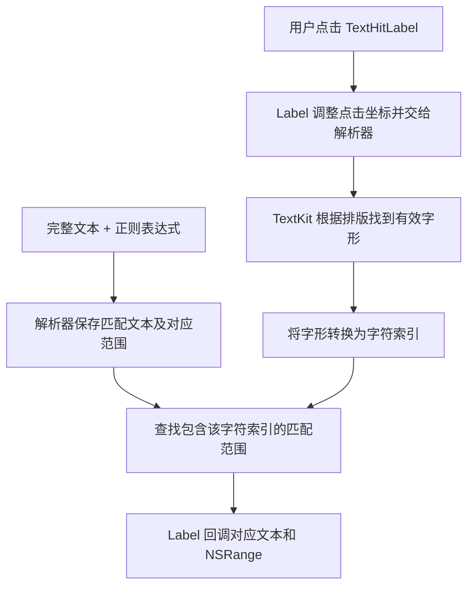

# TextHitKit

基于 UIKit 和 TextKit 的文本点击匹配组件。

## 核心特性

- **文本点击匹配**：根据点击位置查找命中的匹配内容，回调对应文本及其在完整文本中的 `NSRange`。
- **内置规则与自定义扩展**：提供英文单词、字母数字单词和邮箱匹配规则，允许模块外通过 `TextMatchRule` 自定义正则表达式。
- **排版调试对照**：Debug 下使用红色 TextView 叠加显示，方便检查文字位置是否与 Label 一致。

## 重要组成

- **`TextHitLabel`**：文本显示与交互入口，同步字体、对齐、换行及行数等排版属性，处理点击并回调匹配内容；Debug 下通过红色 TextView 对照文字位置。
- **`TextHitResolver`**：文本解析与命中计算，管理 TextKit 排版对象，根据规则生成匹配范围，将点击坐标转换为字符位置，并排除被截断的内容；规则变化时自动重新匹配。
- **`TextMatchRule`**：匹配规则协议，通过正则表达式描述匹配内容，允许模块外自定义规则；内置 `WordMatchRule`、`AlphanumericWordMatchRule` 和 `EmailMatchRule`。

## 模块流程

点击未落在有效字形内、字形被截断或字符索引不属于任何匹配范围时，不回调。

## 测试入口

[TextHitKitDemo](https://github.com/Howard-Zjun/TextHitKitDemo)
